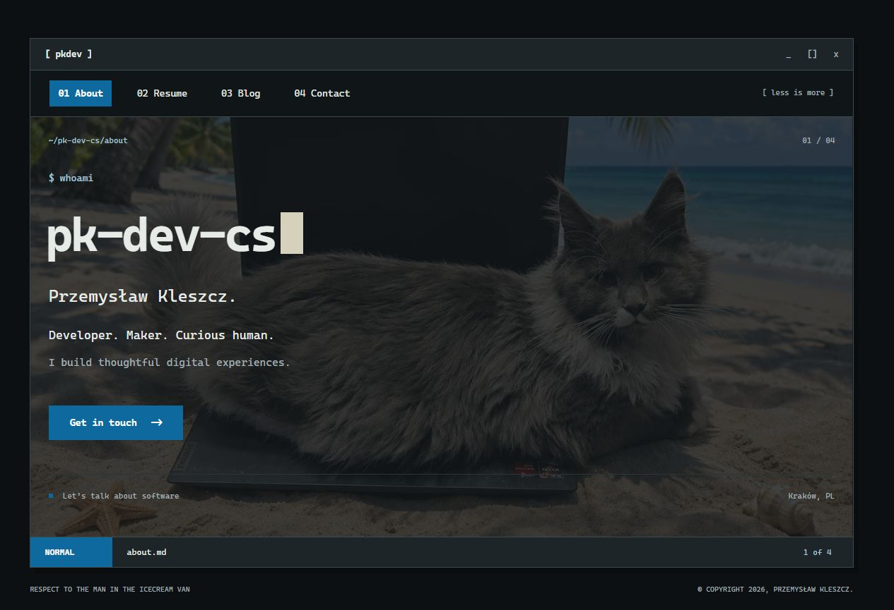

# Personal Website

My personal corner of the web — a little about me, my professional background, things I write, and ways to get in touch.

Built with Astro and TypeScript, with a terminal-inspired interface and a focus on simple, fast pages.

**[Visit the website →](https://personalwebsite-production-d41f.up.railway.app/)**



## About

I'm **Przemysław Kleszcz** (`pk-dev-cs`), a full-stack developer based in Kraków, Poland. This website brings together my background in software development, notes on the web, and contact information.

The design borrows from terminal windows and text editors: numbered navigation, file-like page labels, monospace typography, and a status bar. Underneath, it is a static website with ordinary links and no client-side application framework.

## Features

- **About** — a short introduction and a photographic background.
- **Resume** — professional experience, skills, education, and languages.
- **Blog** — Markdown posts with validated metadata, tags, and draft support.
- **Contact** — email and social links.
- **Custom 404** — a Mechanicum-inspired “Noosphere Connection Lost” page with ASCII art.
- **Search and sharing metadata** — canonical URLs, Open Graph, Twitter cards, and JSON-LD.
- **RSS and sitemap** — generated at build time alongside `robots.txt`.
- **Responsive styling** — desktop and mobile layouts, print styles, and reduced-motion support.

Pages are generated as HTML at build time. There is no executable browser JavaScript, client-side routing, analytics, or external font loading. The only script element contains structured SEO data. Images are optimized by Astro into WebP variants.

## Tech stack

| Area | Technology |
| --- | --- |
| Site generation | Astro 7 |
| Language | TypeScript 6 |
| Content | Markdown and Astro content collections |
| Styling | CSS and system monospace fonts |
| Feeds and discovery | `@astrojs/rss` and `@astrojs/sitemap` |
| Verification | Astro Check and Node.js test runner |
| Hosting | Railway, deployed from GitHub |

## Run locally

Use **Node.js 22.23.4 or newer** and npm.

```sh
git clone https://github.com/pk-dev-cs/PersonalWebsite.git
cd PersonalWebsite
npm ci
npm run dev
```

Open the address printed by Astro, usually [http://127.0.0.1:4321](http://127.0.0.1:4321).

### Commands

| Command | Purpose |
| --- | --- |
| `npm run dev` | Start the local development server |
| `npm run check` | Check Astro files and TypeScript |
| `npm run build` | Generate the static website in `dist/` |
| `npm test` | Verify the generated output; run a build first |
| `npm run preview` | Preview the production build locally |

To check a production build:

```sh
npm run check
npm run build
npm test
```

## Configuration

### Public URL

Copy `.env.example` to `.env` and set `SITE_URL` to the public origin:

```dotenv
SITE_URL=https://personalwebsite-production-d41f.up.railway.app
```

The value must be an HTTP(S) origin without a path, query, or fragment. A build environment variable takes precedence over `.env`. Rebuild after changing it: canonical URLs, feeds, sitemap entries, and sharing metadata are generated during the build.

Without a configured URL, the site uses `https://example.invalid`, adds `noindex, nofollow`, and blocks crawling through `robots.txt`.

### Content and appearance

| File or directory | What to edit |
| --- | --- |
| `src/config.ts` | Profile, resume, contact details, social links, and navigation |
| `src/content/blog/` | Blog posts in Markdown |
| `src/styles/global.css` | Layout, colors, typography, and print styles |
| `src/assets/main-background.png` | About page background |
| `src/assets/przemyslaw-kleszcz.jpg` | Resume portrait; keep a 4:5 aspect ratio |
| `public/social-card.png` | Sharing image, 1200 × 630 px |
| `public/social-card.svg` | Editable sharing image source; re-export the PNG after editing |

## Write a blog post

Add a Markdown file to `src/content/blog/`, for example `my-first-post.md`:

```markdown
---
title: "My first post"
description: "A short description for the blog index, RSS feed, and search engines."
pubDate: 2026-11-04
tags: ["web", "notes"]
draft: false
example: false
---

An opening paragraph.

## A section heading

The rest of the post goes here.
```

The filename becomes the URL: `/blog/my-first-post/`. Start headings in the body at `##`; the page template supplies the main heading.

- Posts marked `draft: true` or dated in the future are excluded from the blog index, post routes, and RSS feed.
- Scheduled posts require a new build when their publication date arrives.
- Optional `updatedDate` must be on or after `pubDate`. Dates are displayed in UTC.
- `example: true` visibly labels sample content. The repository includes two example posts.
- Local images can be imported through Markdown for Astro optimization. Include descriptive alternative text.

## Deployment

The live site runs on Railway under the project and service name **PersonalWebsite**. The service follows `pk-dev-cs/PersonalWebsite` on **`main`**; pushes to that branch trigger automatic deployments.

The current Railway settings are configured in the service dashboard:

| Setting | Value |
| --- | --- |
| Builder | Railpack |
| Build command | `npm run build && npm install --no-save --package-lock=false serve@14.2.4` |
| Start command | `./node_modules/.bin/serve dist --listen tcp://0.0.0.0:$PORT --no-clipboard` |
| Health check | `/` |
| `PORT` | `8080` |
| `RAILPACK_NODE_VERSION` | `24` |
| `SITE_URL` | `https://personalwebsite-production-d41f.up.railway.app` |

The static server is installed during the Railway build. No server-side application or database is required.

For another static host, build the project and publish the contents of `dist/`. Configure directory-style URLs and serve `404.html` with HTTP status **404** for missing pages. Enable HTTPS and compression, and use a long cache lifetime for hashed files under `/_astro/` with a shorter lifetime for HTML and feeds.

## Project structure

```text
config/                 Public URL loading and validation
docs/images/            Screenshots used in this README
public/                 Static assets copied into the build
src/
  assets/               Images processed by Astro
  content/blog/         Markdown blog posts
  content.config.ts     Blog content schema
  config.ts             Personal details and navigation
  layouts/              Shared page layout and metadata
  lib/                  Blog helpers
  pages/                Pages, blog routes, RSS, and robots.txt
  styles/               Global stylesheet
tests/                  Checks against the generated website
```
